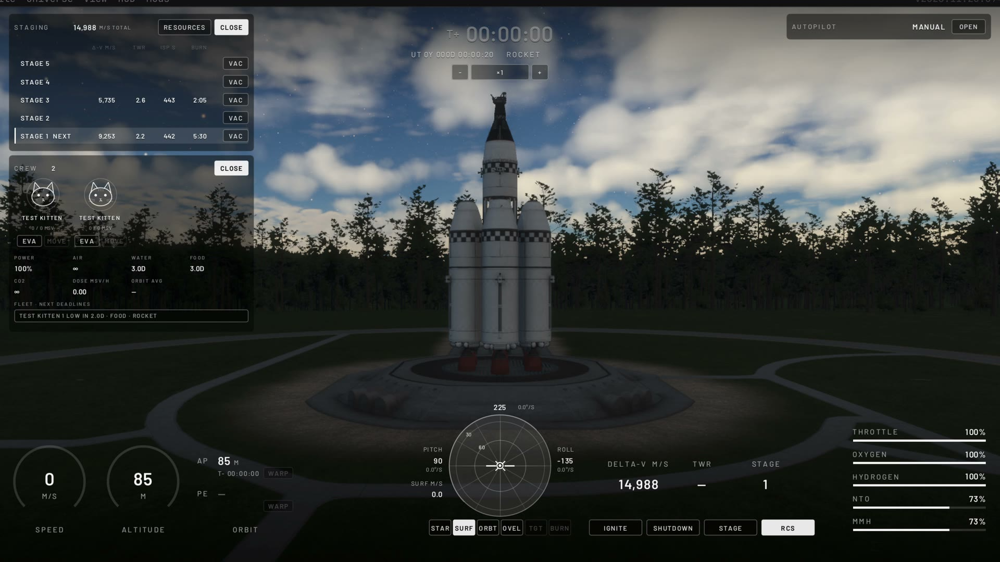
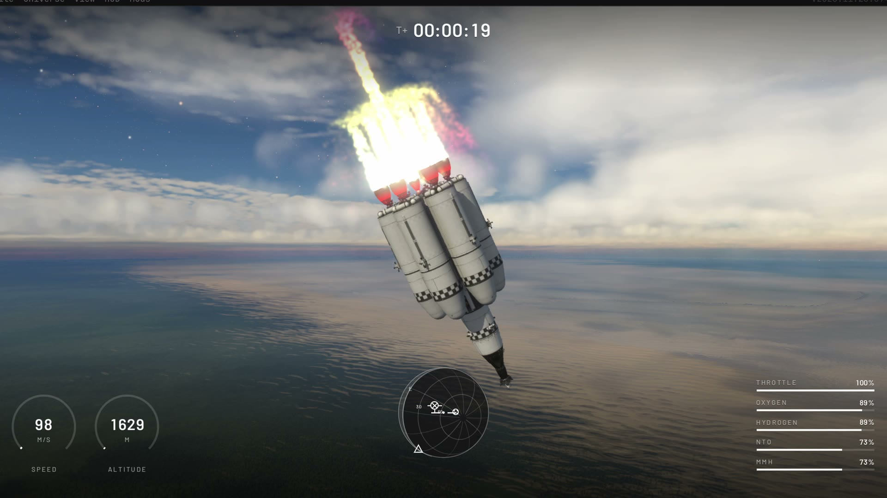
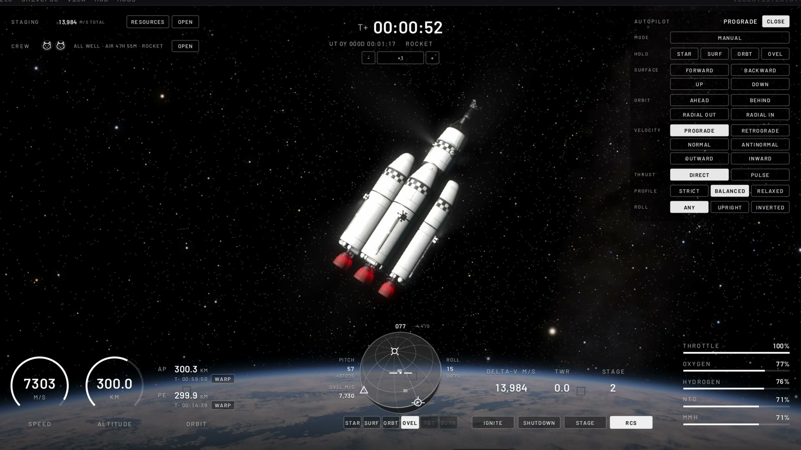
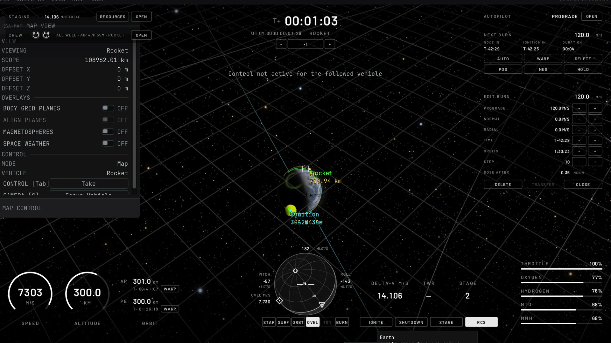
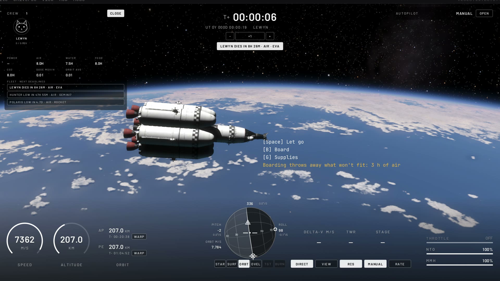

# ModernUI

A flight HUD for [Kitten Space Agency](https://ksa.ahwoo.com) in the style of a launch
webcast: flat, black and white, thin rings and big numbers. It replaces every stock flight
gauge, controls included, and stays out of the way when nothing needs you.



| | |
|---|---|
|  |  |
|  |  |

## What's on screen

| Where | What |
|---|---|
| Bottom left | Speed and altitude rings (speed fills towards orbital speed; altitude towards the top of the atmosphere, then round heights); apoapsis and periapsis, time to each, warp to each |
| Bottom centre | A line-drawn navball with every marker; heading, pitch, roll and their rates; speed in the navball's frame; the frame (STAR SURF ORBT OVEL TGT BURN) |
| Bottom right | Delta-v, TWR, next stage; IGNITE, SHUTDOWN, STAGE, RCS (on EVA: DIRECT, VIEW, RCS, MANUAL, RATE); throttle and propellant bars |
| Top centre | T+ from liftoff, universal time, warp; a near crew deadline and BACK TO the vessel you switched from, only when they apply |
| Top left | Staging: each stage's delta-v, TWR, Isp, burn time, ATM/VAC. Crew as wireframe cats (they blink; they squint when unwell), doses, EVA and MOVE; power, life support, radiation; every vessel's next crew deadline |
| Top right | Autopilot: every mode, hold, target, thrust mode, profile and roll. When they apply: the next burn, the target, and in map view the burn editor |

Every control does what the stock button does, through the same game code, and is lit and
greyed by the same rules.

## Modes

Press **P** to cycle them, or pick one in **Mods → ModernUI mode** in the game's menu bar.

- **CLEAN**: the webcast look. Rings, navball, throttle and propellant bars, T+. No controls.
- **FLIGHT** (default): everything; staging, crew and autopilot are one-line headers that
  open on a click, and the burn and target cards appear only when they apply.
- **FULL**: everything, every panel open.

**Mods → ModernUI** turns the HUD off (the stock gauges come back), and **Mods → ModernUI:
hide stock gauges** keeps the stock gauges alongside it. F2, the game's hide-UI key, hides
it too.

## Install

ModernUI is a code mod: it needs the [StarMap](https://github.com/StarMapLoader/StarMap)
mod loader.

**With [Borea](https://github.com/KSAModding/Borea)** (the community mod manager), once
ModernUI is in its content index: find ModernUI in Discover and install it. Borea installs
StarMap for you.

**By hand:**

1. Download `ModernUI.zip` from the [latest release](../../releases/latest).
2. Unzip it into your mods folder, so that you have `mods/ModernUI/ModernUI.dll`:
   `Documents/My Games/Kitten Space Agency/mods/` (on Windows and Linux), or the `mods`
   folder of your Borea instance.
3. Enable it: add this to `manifest.toml` in the folder above `mods`, or enable it in Borea
   ("Not managed by Borea").
   ```toml
   [[mods]]
   id = "ModernUI"
   enabled = true
   ```
4. Start the game through StarMap (or Borea's Play). Starting the game directly skips the
   loader.

Your choices (mode, open panels) are saved in `ModernUI/settings.json` in the game's
profile folder, so updating the mod keeps them.

## Compatibility

- Built for KSA **2026.11.25.5949** with StarMap **0.5.4**. KSA is in pre-alpha and code
  mods reach into the game's internals, so a game update can break ModernUI until it is
  updated.
- Tested on **Windows** and **macOS** (the [Mac port](https://github.com/renancamm/ksa-macos-port)).
  Linux is untested; reports are welcome.
- Other mods that replace or hide the stock HUD (CompactHUD, ReGUI) will overlap with it.

## Known limitations

- The game's own windows (Resource Groups, the map view panel) take clicks over the HUD
  where they overlap it.
- MOVE (moving a kitten to another seat) is untested on vessels with free seats.

## Development

See [docs/DEVELOPING.md](docs/DEVELOPING.md): how it works, building, and the dev tools
(a test bridge that drives the game for screenshots, a smoke test, the demo recorder).

## Credits and license

ModernUI is MIT-licensed (see [LICENSE](LICENSE)). It uses the
[Barlow](https://github.com/jpt/barlow) typeface (SIL Open Font License), follows
[KSA-ReGUI](https://github.com/wide-frog/KSA-ReGUI) for some flight values, and its
development tools adapt parts of the
[Kitten Space Agency Mac port](https://github.com/renancamm/ksa-macos-port); see
[THIRD_PARTY_NOTICES.md](THIRD_PARTY_NOTICES.md).

ModernUI is a fan-made mod, not affiliated with RocketWerkz. Kitten Space Agency is
developed by [RocketWerkz](https://www.rocketwerkz.com).
